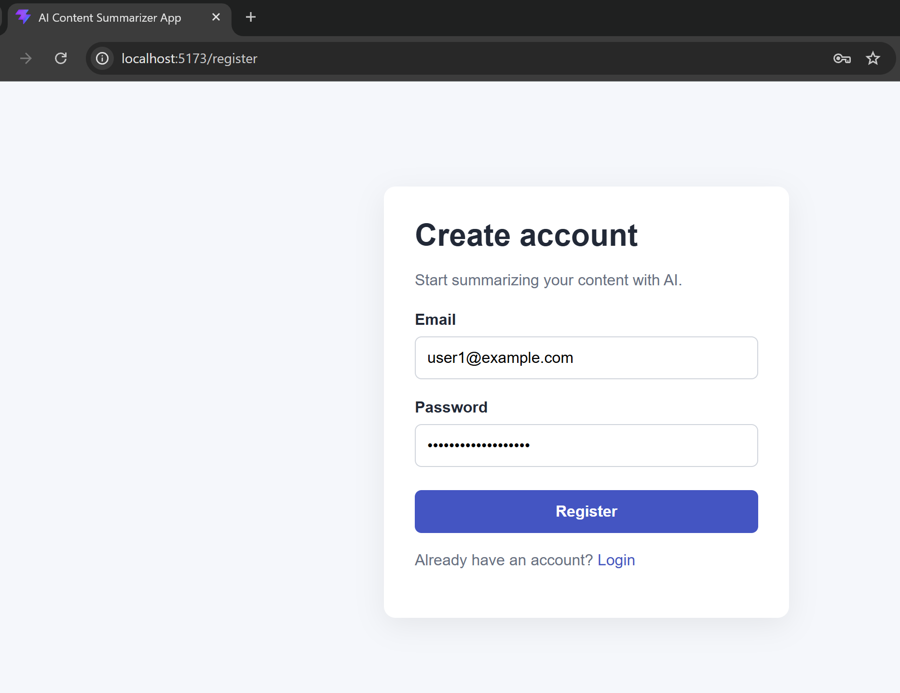
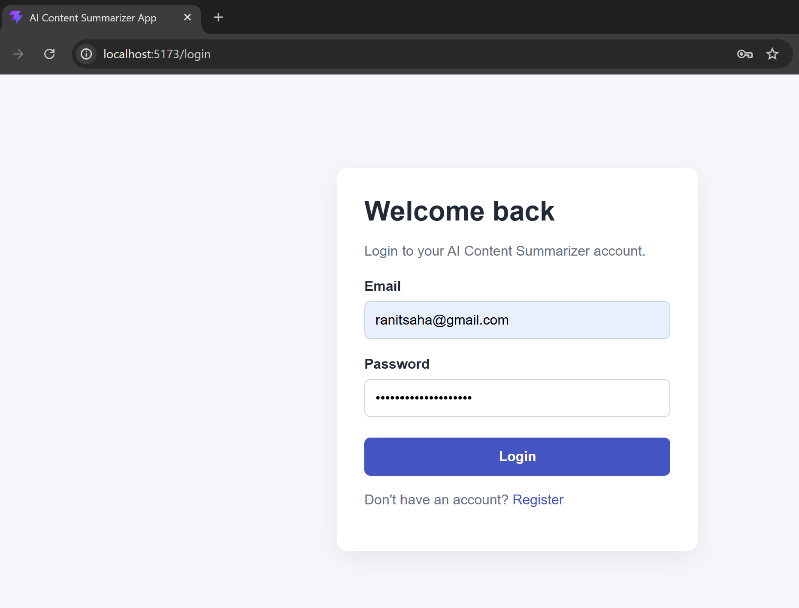
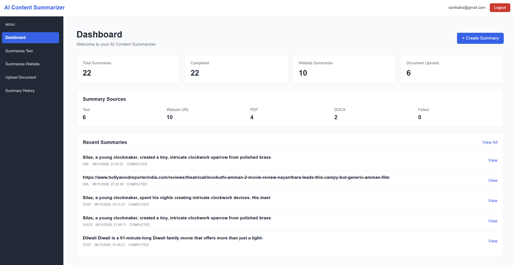
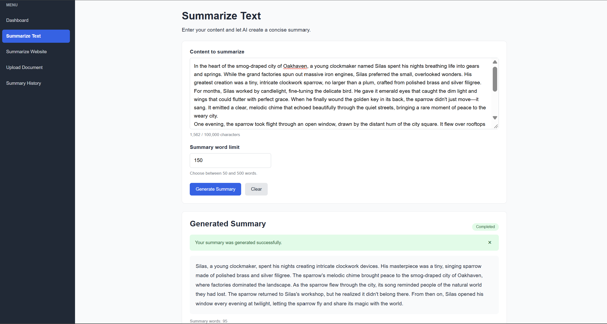
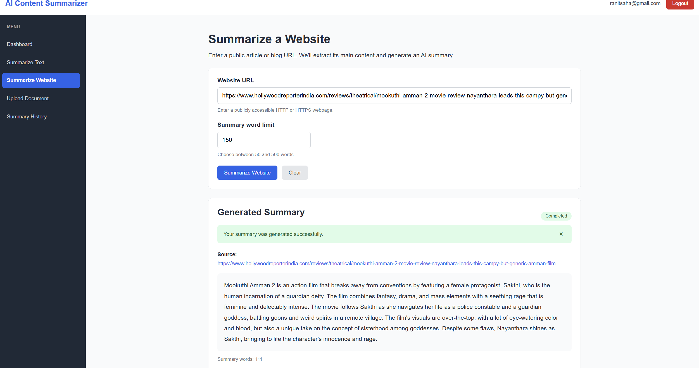
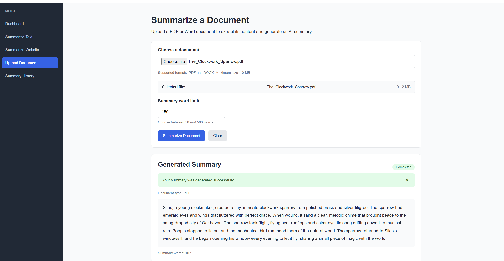
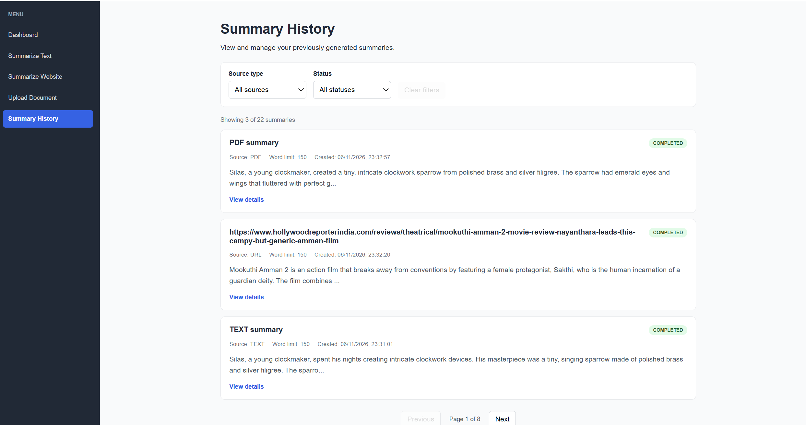
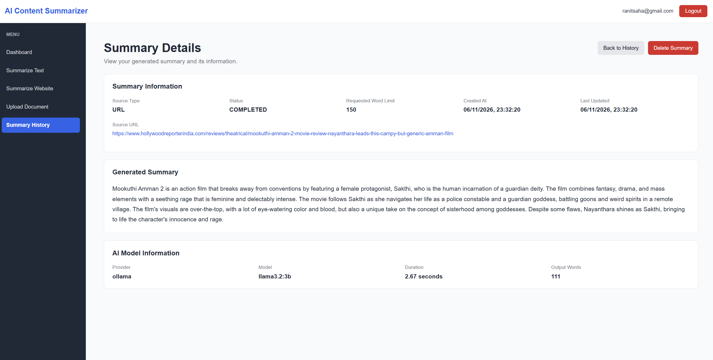
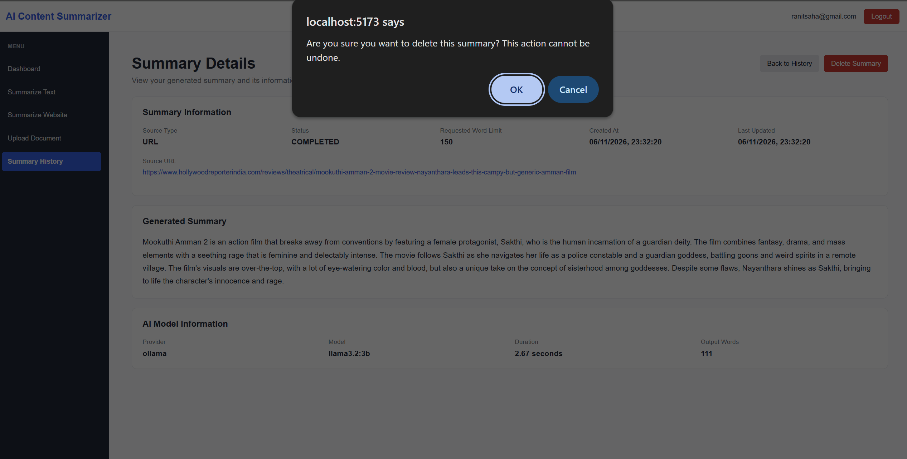

# AI Content Summarizer

An AI-powered content summarization application built with Node.js, Express, React, PostgreSQL, Prisma and Ollama.

Users can summarize text, website articles, PDF documents and DOCX documents using a locally hosted AI model.

## Features

- User registration and JWT authentication
- Text summarization with configurable word limits
- Website content extraction and summarization
- PDF and DOCX document summarization
- AI-powered summaries using Ollama
- Summary history with pagination and filtering
- Summary details and deletion
- Dashboard statistics
- User-specific data and ownership protection
- Input validation and centralized error handling
- Rate limiting and security headers
- Automated tests
- Swagger API documentation
- Docker support

## Technology Stack

### Backend
- Node.js
- Express.js
- PostgreSQL
- Prisma ORM
- Zod
- JWT
- Argon2id
- Ollama

### Frontend
- React
- Vite
- React Router
- Axios

### Testing and Tools
- Vitest
- Supertest
- Swagger / OpenAPI
- Docker and Docker Compose
- Git and GitHub

## Project Structure

```text
ai-content-summarizer/
├── backend/
│   ├── src/
│   ├── prisma/
│   └── tests/
├── frontend/
│   └── src/
└── README.md
```

## Prerequisites

- Node.js
- PostgreSQL
- Ollama
- Git

## Local Setup

1. Clone the repository.

2. Install backend dependencies:

   cd backend
   npm install

3. Configure backend environment variables using .env.example.

4. Generate the Prisma client and apply database migrations:

   npx prisma generate
   npx prisma migrate dev

5. Start the backend:

   npm run dev

6. Install frontend dependencies:

   cd ../frontend
   npm install

7. Configure the frontend environment variables using .env.example.

8. Start the frontend:

   npm run dev

## AI Model

This project uses Ollama for local AI inference.

Default model: llama3.2:3b

Install Ollama and download the model before generating summaries.

## API Documentation

Swagger UI:

http://localhost:5000/api-docs

## Docker

Docker Compose configuration is provided for running the application using containers.

See the Docker setup instructions for environment configuration and startup commands.

## Security

- Passwords are hashed using Argon2id.
- JWT authentication protects private APIs.
- User-specific records are protected through ownership checks.
- Input validation is performed using Zod.
- Website extraction includes SSRF protections.
- File upload size and file-type checks are implemented.
- Environment secrets are excluded from source control.

## Project Status

Development and testing in progress.

## Applicatio Screenshots




















